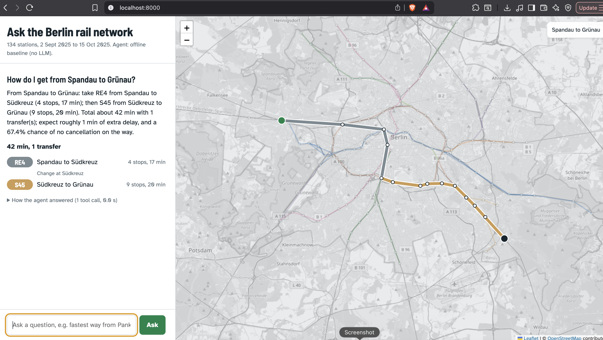
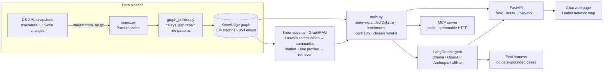

# Berlin Transit Graph Agent

**A GraphRAG agent over a delay-aware knowledge graph of Berlin's rail network.**
Ask questions in plain English or German. A LangGraph agent answers them by calling graph-algorithm tools (routing, isochrones, centrality, what-if closures) and a GraphRAG retriever, and the chat web page draws each answer on an interactive network map. The tools are also exposed as an **MCP server** and a **FastAPI** service.

Built on **2.08 million real stop events** (DB Timetables API snapshots, 2 Sep – 15 Oct 2025, 134 stations, 76 lines) from the [DBahn-Berlin dataset](https://github.com/damslab/datasets/tree/master/DBahn-berlin). This is a follow-up to my [Berlin Public Transport Data Analysis](https://github.com/gulerece/Berlin-Public-Transport-Data-Analysis) project, which used the same data for SQL/Spark analytics and BFS/Dijkstra routing.



```
> What happens if Ostkreuz is closed?
tools: closure_impact(station="Ostkreuz")
If Ostkreuz closed, 78 neighbouring journeys would be affected, 34 of them with no rail
alternative; the others take 21.8 min longer on average. It is an articulation point:
closing it splits the network. Worst case: Alexanderplatz → Rummelsburg goes from 11 min
to no alternative.
```

## Architecture



## What's inside

| Layer | What it does | Notable details |
|---|---|---|
| **Ingestion** | Streams ~676k XML files straight out of the weekly `.tar.gz` archives into Parquet | 6 weeks in ~2 min; categorical dtypes and a child process keep peak memory bounded |
| **Graph construction** | Stations become nodes, consecutive stops become directed edges carrying per-line median travel time, delay gained and cancellation rate | **Gap repair:** many S-Bahn platform records (e.g. Alexanderplatz S-Bahn) are missing from the raw data, so trips appear to skip stations. The planned-path attribute (`ppth`) still names them, so 42% of segments are rebuilt through the missing stations. Unrepairable gaps are dropped instead of inventing express links. |
| **Graph tools** | `plan_route`, `reachable_within`, `hub_ranking`, `delay_hotspots`, `closure_impact`, `station_info`, `line_info`, `nearest_station` | Routing runs Dijkstra over **(station, line) states** so that changing lines costs a transfer penalty. `optimize="reliable"` adds observed delay gain plus cancellation risk to the edge weights. Closure analysis uses articulation points and re-routes affected journeys. |
| **GraphRAG** | Louvain community detection, then templated community summaries ("global"), plus station and line profiles ("local") | Station hits are expanded with their community summary (graph-guided context expansion). Retrieval uses TF-IDF (offline, deterministic) or any LangChain `Embeddings`. |
| **Agent** | LangGraph `StateGraph` with an agent ↔ ToolNode loop | Swappable LLM backend. Internal parameters are hidden from the LLM's tool schemas. The `offline` rule-based router is the baseline and runs in CI without API keys. |
| **Web page** | Chat interface with an interactive Leaflet map of the network | Draws routes, isochrones, closures, hubs and delay hotspots in the real S-Bahn line colours. Shows the journey legs as line badges, lists the tool calls behind each answer, and lets you click a station to ask about it. |
| **Serving** | FastAPI (`/ask`, `/route`, `/hubs`, `/network`, ...) and an MCP server (stdio and HTTP) | Docker Compose with an optional Ollama container |
| **Quality** | 32 pytest tests, ruff, GitHub Actions (tests, eval, Docker smoke test) | Synthetic XML fixture tests the delay and gap-repair logic exactly |

## Findings from the data (Sep–Oct 2025)

- **Most critical hubs (betweenness):** Ostkreuz (0.38), Südkreuz (0.31), Gesundbrunnen (0.27), Bornholmer Str. (0.24), Hbf (0.24).
- **Least punctual stations:** Ostbahnhof (73.7% of arrivals under 6 min late), Hbf (75.1%) and Spandau (75.8%), all long-distance/regional hubs. The median station is 97.4% punctual, so S-Bahn-only stations are far more reliable.
- **Where delay builds up:** Ostkreuz → Gesundbrunnen (+2.6 min per train, FEX/IC) and Gesundbrunnen → Lichtenberg (+1.9 min).
- **Single points of failure:** Ostkreuz is an articulation point. Closing it cuts off the S3 branch from Rummelsburg to Wilhelmshagen (34 neighbour journeys lose all rail alternatives). Closing Friedrichstraße adds 15 min on average but disconnects nothing.

## Agent benchmark

`evals/` generates **66 test cases whose ground truth comes from the graph itself**: routes, closures, isochrones, station facts, hubs, delays and lines. Questions mix English and German, aliases ("Alex", "Hauptbahnhof") and typos ("Nikoassee", "Frankfurtr Allee"). Scoring covers **tool selection**, **argument (station) resolution** and **fact recall** (numbers within tolerance).

| agent | tool acc. | arg acc. | fact recall | p50 latency |
|---|---|---|---|---|
| offline rule-based router (baseline) | 86% | 91% | 92% | 0.01 s |
| Llama 3.1 8B (Ollama), v1 | 96% | 98% | 79% | 5.8 s |
| **Llama 3.1 8B (Ollama), v2** | **98%** | **98%** | **91%** | 5.2 s |

**v1 → v2:** error analysis of v1 showed the LLM set `optimize="reliable"` without being asked (giving slower routes), passed internal parameters, and dropped headline numbers from its answers. v2 hides internal parameters from the tool schemas, tightens the system prompt, and raises the context window from 4k to 8k tokens; fact recall rose from 79% to 91%.

**Takeaway:** the LLM agent is much better at understanding questions (98% vs 86% tool accuracy, and robust to typos and paraphrases). Its answers now include the right facts about as often as the hand-written templates (91% vs 92%), at a cost of ~5 s latency on a laptop.

**Remaining failure modes:** omitting the station count in reachability answers, writing a retry tool call as plain text instead of calling the tool (a known Llama 3.1 behaviour), and one case of confusing two tools.

Run it yourself:

```bash
python evals/run_evals.py --provider offline
python evals/run_evals.py --provider ollama --model llama3.1:8b
```

Per-case results are written to `evals/results/`.

## Quickstart

```bash
python3.12 -m venv .venv && source .venv/bin/activate   # Python ≥ 3.11
pip install -e ".[dev,ollama]"
pytest -q                             # 32 tests, uses the committed graph

# ask questions in the terminal (offline baseline: no API key needed)
transit-graph ask "Most reliable way from Spandau to Grünau?" --trace

# with a local LLM (free, runs on your machine)
ollama pull llama3.1:8b
transit-graph chat --provider ollama --model llama3.1:8b

# chat web page + REST API on :8000  (API docs at /docs)
uvicorn transit_graph.api:app --reload
# then open http://localhost:8000

# the same, answered by the LLM
TRANSIT_LLM_PROVIDER=ollama TRANSIT_LLM_MODEL=llama3.1:8b uvicorn transit_graph.api:app --reload

# REST example
curl "localhost:8000/route?origin=Alex&destination=Wannsee&optimize=reliable"

# everything in Docker
docker compose up --build
```

### Use it from any MCP client (Claude Desktop, Cursor, ...)

```json
{ "mcpServers": { "berlin-transit-graph": {
    "command": "transit-graph-mcp",
    "env": { "TRANSIT_GRAPH_PATH": "/abs/path/to/data/graph.json.gz" } } } }
```

### Rebuild the graph from raw data

```bash
make data                          # sparse-clones the dataset (~190 MB)
make graph WEEKS=all               # or WEEKS=250902_250909 for one week
```

The committed `data/graph.json.gz` (29 KB) is the six-week graph, so nothing has to be downloaded to try the project.

## Project layout

```
src/transit_graph/
  ingest.py         XML archives → Parquet (stops, changes, stations)
  graph_builder.py  delays, gap repair, edges, line patterns → graph.json.gz
  tools.py          routing, isochrones, centrality, hotspots, closure what-if
  knowledge.py      GraphRAG: communities, summaries, retriever
  agent.py          LangGraph agent + LLM provider factory
  offline.py        rule-based tool-calling baseline model
  mcp_server.py     MCP server
  api.py            FastAPI service + /network endpoint for the map
  static/           chat web page (index.html)
  evals.py          case generation + scoring
evals/              benchmark runner, cases, results
tests/              pytest suite (incl. synthetic XML fixture)
docs/               design notes, screenshot
```

## Limitations

- Travel times are *planned* medians over the observation window, not a live timetable. Routing ignores departure times and waiting (unlike the earliest-arrival Dijkstra in the original project); a fixed transfer buffer (default 5 min) stands in for waiting.
- The dataset covers DB stations only, so **U-Bahn, tram and bus are missing**, and lines end at the Berlin city border. "No rail alternative" in closure analysis means no alternative within the S-Bahn/regional network.
- When a station has no change record, the train is assumed to be on time. This is how the DB API reports deviations, but it may undercount delays during data outages.
- On the map, each stretch of shared track is drawn in one line's colour; hover it to see every line that uses it. Three stations rebuilt from planned paths (Karlshorst, Wuhletal, Wagner-Regeny-Allee) are placed at approximate positions.

## Next steps

- Add U-Bahn and tram from VBB's public GTFS timetable data
- Time-dependent routing (earliest arrival) on the stop-event table
- Fix the remaining LLM failure modes (e.g. parse text-formatted tool calls, structured answer templates)
- A GNN (PyTorch Geometric) predicting delay propagation along edges
- Neo4j export for Cypher queries

---
Ece Güler · M.Sc. Computer Science, TU Berlin · MIT License